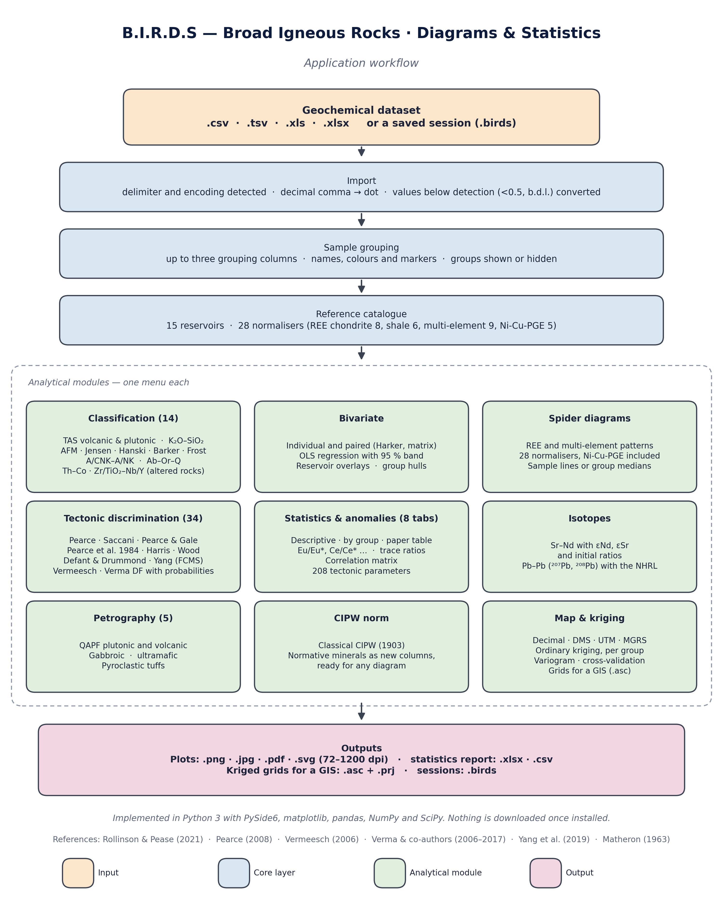

<div align="center">


# B.I.R.D.S

**Broad Igneous Rocks — Diagrams & Statistics**

A desktop application for plotting, classifying and analysing whole-rock
geochemical data of igneous rocks.

[](LICENSE)
[](https://www.python.org/downloads/)
[](https://doc.qt.io/qtforpython/)
[](#status)
[](#development-and-testing)

</div>

---

## What it is

B.I.R.D.S turns a spreadsheet of whole-rock analyses into publication-ready
petrological figures without writing a line of code. You import a table of
major oxides, trace elements, isotope ratios or modal counts, and every
classification, discrimination and normalisation scheme in the literature is
one menu click away — each drawn from its original publication, each labelled
with its source.

It is built for the working petrologist: the sample that does not appear on a
diagram is *accounted for* rather than silently dropped, below-detection
values are handled explicitly instead of becoming blanks, and the figure you
export is sized in millimetres for the journal you are submitting to.

**62 diagram templates · 28 published normalisers · classical CIPW norm ·
8-tab statistics dashboard**

---

## Table of contents

- [Highlights](#highlights)
- [The interface](#the-interface)
- [Diagram catalogue](#diagram-catalogue)
- [Data handling](#data-handling)
- [Statistics and anomalies](#statistics-and-anomalies)
- [Export and reproducibility](#export-and-reproducibility)
- [Input data format](#input-data-format)
- [Installation](#installation)
- [Quick start](#quick-start)
- [Keyboard shortcuts](#keyboard-shortcuts)
- [Development and testing](#development-and-testing)
- [Project layout](#project-layout)
- [Status](#status)
- [Citation](#citation)
- [License](#license)

---

## Highlights

| | |
|---|---|
| **Everything is sourced** | Field boundaries and discriminant functions are transcribed, measured or recomputed from the original paper rather than redrawn by eye, and [`docs/DIAGRAM_PROVENANCE.md`](docs/DIAGRAM_PROVENANCE.md) says which of the three it was, diagram by diagram — and none is left drawn by eye. Each plot carries its citation in the subtitle, and `References → Show full bibliography` prints the complete APA list. |
| **No silent data loss** | A counter under every canvas reports how many samples were plotted, filtered, hidden or missing the required elements — and clicking any of those numbers lists the samples by name. |
| **Detection limits are real values** | `<0.5`, `≤0.2`, `b.d.l.`, `n.d.` are parsed at import and substituted under an explicit policy (x/2, x/√2 or blank), flagged in amber in the data table, and the policy can be changed afterwards without re-importing. |
| **Cross-view sample identification** | Modifier-click a point in any view to highlight the same sample in every other view. |
| **Journal-ready output** | Figure export in PDF, SVG, EPS, PNG and JPEG, sized by journal column presets in millimetres, with absolute-point font scaling. |
| **Reproducible sessions** | The whole working state — data, diagrams, styling, annotations — saves to a single `.birds` file. Symbology alone travels as a reusable `.birdstyle` preset. |

---

## The interface

A single window with a menu bar across the top and one stacked view per
diagram family. Data flows through the application like this:

<div align="center">

</div>

The menu bar is organised by what you want to *do*, not by how the code is
structured:

| Menu | What lives there |
|---|---|
| **Data** | Import, data table, detection limits, plot styling, style presets, pre-processing, sessions, export |
| **Classification diagrams** | TAS and the rest of the compositional classification schemes, split volcanic / plutonic |
| **Bivariate diagrams** | Harker-style plots, single or in grids, with regressions and annotations; analysed and adjusted majors side by side, and Mg# as an axis |
| **Spider diagrams** | REE, multi-element and Ni-Cu-PGE metal patterns with 28 normalisers |
| **Tectonic diagrams** | Discrimination schemes, grouped by composition and rock family |
| **Norm** | CIPW normative mineralogy |
| **Petrography** | Modal ternaries (QAPF, gabbro, ultramafic, tuff) and pyroclastic rocks by fragment size |
| **Isotopes** | Sr-Nd and Pb-Pb systematics |
| **Map** | Sample locations on longitude/latitude axes, from decimal, DMS, UTM or MGRS coordinates, and ordinary kriging of any numeric column — per group or pooled — with its uncertainty, variogram and cross-validation, exportable as ESRI ASCII grids for a GIS |
| **Statistics and Anomalies** | Descriptive statistics, anomalies, correlations, paper tables |
| **References** | The full bibliography behind every diagram |

---

## Diagram catalogue

<details>
<summary><b>Classification — volcanic (9)</b></summary>

- TAS — Le Bas et al. 1986 / Le Maitre 2002
- K₂O vs SiO₂ — Peccerillo & Taylor 1976
- Th vs Co (altered arc rocks) — Hastie et al. 2007
- Zr/TiO₂ vs Nb/Y (altered rocks) — Winchester & Floyd 1977
- Alkalic / sub-alkalic boundary — Irvine & Baragar 1971
- AFM — Irvine & Baragar 1971 / Kuno 1968 / new (Rollinson 2021)
- Jensen cation plot, Al–(Fe+Ti)–Mg — Jensen 1976
- Hanski high-Mg plot — Hanski et al. 2001
- High-Mg subdivision on TAS — Le Maitre 2002

</details>

<details>
<summary><b>Classification — plutonic (5)</b></summary>

- TAS plutonic — Middlemost 1994
- Normative An–Ab–Or — Barker 1979
- Fe-index, MALI, ASI, AI, FSSI — Frost et al. 2001 / Frost & Frost 2008
- A/CNK vs A/NK — Maniar & Piccoli 1989
- Ab–Or–Q haplogranite system — Tuttle & Bowen 1958

</details>

<details>
<summary><b>Tectonic discrimination — mafic (23)</b></summary>

- Th/Yb vs Nb/Yb and Ti/Yb vs Nb/Yb — Pearce 2008
- Nb<sub>N</sub> vs Th<sub>N</sub>, Dy<sub>N</sub> vs Yb<sub>N</sub> (IAT vs boninite),
  Ce<sub>N</sub>/Yb<sub>N</sub> vs Dy<sub>N</sub>/Yb<sub>N</sub> (N-MORB vs G-MORB) — Saccani 2015
- Ti/Y vs Zr/Y — Pearce & Gale 1977
- Ti vs V — Shervais 1982 / Vermeesch 2006
- Zr vs Ti — Pearce & Cann 1973 / Vermeesch 2006
- Five Vermeesch (2006) ternaries: Na/100–25Nb–Sr, Si/1000–Ti/40–Sr,
  100Eu–500Lu–Sr, V–Ti/50–5Sc, 50Sm–Ti/50–V
- Th–Hf/3–Ta ternary — Wood 1980 / Vermeesch 2006
- La/10–Y/15–Nb/8 ternary — Cabanis & Lecolle 1989
- Major-element DF (no FeO) — Pearce 1976 / Vermeesch 2006
- TiO₂–Zr–Y–Sr DF — Butler & Woronow / Vermeesch 2006
- Adjusted-majors DF set, 5 panels — Agrawal et al. 2004
- Major log-ratio DF set, 5 panels — Verma et al. 2006
- La–Sm–Yb–Nb–Th DF set, 5 panels — Agrawal et al. 2008
- TiO₂–Nb–V–Y–Zr DF set, 5 panels — Verma & Agrawal 2011
- FCMS / FCKANTMS source proxy — Yang et al. 2019

</details>

<details>
<summary><b>Tectonic discrimination — intermediate (8)</b></summary>

- Y vs Sr/Y (adakite) — Defant & Drummond 1990
- Y vs Sr/Y, adakite field drawn — Defant & Drummond 1993
- Yb<sub>N</sub> vs (La/Yb)<sub>N</sub>, Archean TTG, post-Archean and MORB — Drummond & Defant 1990 (JGR)
- Y vs Sr/Y, high-Al TTD vs island-arc ADR — Drummond & Defant 1990 (JGR)
- Yb<sub>N</sub> vs (La/Yb)<sub>N</sub>, Archean TTG vs post-Archean granitoids — Martin 1986
- Majors DF set, 5 panels — Verma & Verma 2013
- Immobile majors + traces DF set, 5 panels — Verma & Verma 2013
- Immobile traces DF set, 5 panels — Verma & Verma 2013

</details>

<details>
<summary><b>Tectonic discrimination — acid (12)</b></summary>

- Yb vs Ta, Y vs Nb, (Yb+Ta) vs Rb, (Y+Nb) vs Rb — Pearce et al. 1984
- Hf–Rb/10–3Ta ternary — Harris et al. 1986
- Yb<sub>N</sub> vs (La/Yb)<sub>N</sub> and Y vs Sr/Y — Drummond & Defant 1990 (JGR)
- Yb<sub>N</sub> vs (La/Yb)<sub>N</sub>, Archean TTG vs post-Archean granitoids — Martin 1986
- Majors DF set, 5 panels — Verma et al. 2012
- Majors DF set, 5 panels — Verma et al. 2013
- Immobile majors + traces DF set, 5 panels — Verma et al. 2013
- Immobile traces DF set, 5 panels — Verma et al. 2013

</details>

<details>
<summary><b>Tectonic discrimination — mafic to felsic (2)</b></summary>

- Th/Nb vs Nb/Yb, nine settings — Li, Godang & Saputro 2025
- Th/Nb vs Nb/Zr — Godang, Saputro & Li 2024

</details>

<details>
<summary><b>Spider diagrams — 28 normalisers</b></summary>

**REE chondrites (8)** — Sun & McDonough 1989 (CI), McDonough & Sun 1995 (CI),
Anders & Grevesse 1989 (CI avg), Pourmand et al. 2012, Barrat et al. 2012
(Orgueil), Boynton 1984, Taylor & McLennan 1985 (CI calc. volatile-free),
Wakita et al. 1971 (ordinary chondrites).

**REE shales (6)** — NASC (McLennan 1989), PAAS (Pourmand et al. 2012),
MUQ (Kamber et al. 2005), European Shale (Bau et al. 2018), World Shale
Average (Bau et al. 2018), Upper Continental Crust (Rudnick & Gao 2014).

**Multi-element (9)** — Primitive Mantle (McDonough & Sun 1995; Palme &
O'Neill 2014), CI Chondrite (McDonough & Sun 1995), N-MORB and E-MORB
(Sun & McDonough 1989), Global MORB log-normal mean (Arevalo & McDonough 2010), Upper and
Bulk Continental Crust (Rudnick & Gao 2014), NASC (Gromet et al. 1984).

**Ni-Cu-PGE metals (5)** — Primitive Mantle (McDonough & Sun 1995),
Primitive Upper Mantle (Becker et al. 2006), Primitive Mantle
(Fischer-Gödde et al. 2011), CI Chondrite (Fischer-Gödde et al. 2010),
Depleted MORB Mantle (Salters & Stracke 2004). These carry their own x-axis —
Ni · Os · Ir · Ru · Rh · Pt · Pd · Au · Cu, ordered by compatibility with
sulphide liquid rather than by incompatibility — and are offered in both
the REE and the multi-element tabs, so a magmatic-sulphide study can sit
its metal pattern next to its REE pattern. Every value is checked page by
page against its paper and pinned to its table in
`tests/test_normalizations.py`; the primitive mantle often cited as
Barnes & Maier (1999) is McDonough & Sun's (1995), and goes by their name.

Patterns can be drawn per sample or per group, with min–max / P10–P90 /
P25–P75 envelopes, editable reservoir lines and full annotation support.

</details>

<details>
<summary><b>Petrography — modal and pyroclastic ternaries (6)</b></summary>

- Streckeisen QAPF — plutonic
- Streckeisen QAPF — volcanic
- Gabbroic rocks — Pl / Px / Ol
- Ultramafic rocks — Ol / Opx / Cpx
- Tuffs — Vitric / Crystal / Lithic — Schmid 1981
- Pyroclastic rocks — Blocks and bombs / Lapilli / Ash — Fisher 1966

The modal ones follow the IUGS recommendations, including the 5 % and
10 % rules; Fisher's lines are at thirds, as he drew them.

</details>

<details>
<summary><b>Isotopes (3)</b></summary>

- ⁸⁷Sr/⁸⁶Sr vs ¹⁴³Nd/¹⁴⁴Nd — with mantle reservoirs, the mantle array and
  secondary εNd / εSr axes. εSr is referred to the bulk silicate Earth of
  Zindler & Hart (1986), 0.7051, so that εSr = 0 falls on the BSE line;
  εNd to CHUR (Jacobsen & Wasserburg 1980). Initial ε values are taken
  against the reservoirs as they were at the sample's age.
- ²⁰⁶Pb/²⁰⁴Pb vs ²⁰⁷Pb/²⁰⁴Pb
- ²⁰⁶Pb/²⁰⁴Pb vs ²⁰⁸Pb/²⁰⁴Pb — with the Northern Hemisphere Reference Line
  (NHRL; Hart 1984)

</details>

---

## Data handling

**Import.** Reads CSV, TSV, XLS and XLSX. The reader is deliberately
forgiving: it detects the delimiter, the encoding and decimal commas, and
lets you pick which Excel sheet feeds each of the three tables (Data,
Isotopes, Petrography). The three sheets stay independent — a sample with
Sr-Nd data but no bulk analysis still plots in the Isotopes view.

**Detection limits.** Censored values (`<0.5`, `≤0.2`, `<LOD`, `b.d.l.`,
`n.d.`, `—`) are recognised at import and substituted under a policy you
choose: **x/2** (the usual convention), **x/√2** (Croghan & Egeghy 2003) or
**blank**. Substituted cells are tinted amber in the data table, the reported
limits are kept, and `Data → Detection limits…` switches the policy later
without re-importing. Textual markers carry no limit and stay blank under
every policy.

**Data table** (`Ctrl+T`). An editable grid over the loaded sheets: fix a
typo, add or delete rows and columns, and add the `Group` or `Rock_type`
column the source file never had. Every change — cell edits included — goes
through an undo stack (`Ctrl+Z` / `Ctrl+Shift+Z`).

**Pre-processing.** Rescales major oxides to 100 wt % and partitions total
iron between Fe₂O₃ and FeO following Middlemost (1989) or Le Maitre (1976).
The analysed values are kept; the adjusted ones are added beside them as
`SiO2_adj`, `TiO2_adj`, …. Every view that reads majors — classification,
tectonic, multi-element spider, CIPW norm, statistics — shows one shared
**Major elements** switch saying which of the two its diagrams use, and the
Bivariate view lists each `*_adj` column next to its oxide, with `Mg#`,
`Mg#_FeOt` and `Mg#_adj` offered as axes.

**Sample accounting.** Under every canvas, a counter reports the fate of each
sample: plotted, removed by a filter, hidden with its group, or missing the
elements the diagram needs. Click any number to list the samples by name and
copy the list.

**Brushing.** Modifier-click a point to select that sample; the selection is
shared across the classification, tectonic, spider, map, bivariate and
isotope views, so you can follow one sample through every diagram.

---

## Statistics and anomalies

An eight-tab dashboard:

1. **Descriptive** — n, mean, SD, median, min, max, quartiles per element,
   trace ratio and anomaly
2. **By group** — the same, split by your grouping columns
3. **Paper table** — mean ± SD formatted to significant figures, ready to
   paste into a manuscript as Markdown, LaTeX or TSV; trace ratios and
   anomalies can be ticked in
4. **Anomalies & ratios** — Eu/Eu*, Ce/Ce*, Mg#, CIA and the Ishikawa
   alteration index
5. **Trace-element ratios** — the usual diagnostic ratios, Nb/U and Ce/Pb
   among them
6. **Correlation matrix** — heat-map with selectable method, over elements,
   ratios and anomalies
7. **Tectonic discrimination** — probability tables for the multidimensional
   schemes
8. **Plots** — box, violin, histogram, density and scatter-matrix panels

The **CIPW norm** module (`Norm` menu) computes the classical
Cross-Iddings-Pirsson-Washington (1902) normative mineralogy, writes the
normative columns back into the dataset and exports a multi-sheet XLSX
report. Because the minerals are written back as ordinary columns, they
become plottable immediately: `norm_An` vs `norm_Q`, or any normative
mineral against a measured oxide, appears in the Bivariate variable
pickers as soon as the norm is computed. Pre-processing behaves the same
way — the columns it adds show up without a reload.

---

## Export and reproducibility

**Figures.** PDF, SVG, EPS, PNG and JPEG. The export dialog carries journal
column-width presets in millimetres and aspect-ratio presets, and scales
every text element so the labels land at the requested printed point size.
`Ctrl+Shift+V` copies the current figure to the clipboard at 300 dpi on a
white background, ready to paste into Word or PowerPoint.

**Sessions.** `Ctrl+S` writes a `.birds` file — a ZIP holding the data as
Parquet plus the complete interface state as JSON: which diagram each view
shows, every styling choice, annotations and axis settings. Re-open it and
you are exactly where you left off.

**Style presets.** A `.birdstyle` file carries the symbology alone — point
size, transparency, grouping columns, per-group colours and markers — so
every figure across a manuscript matches, even between different projects.

**Reports.** Statistics export to XLSX, DOCX and PDF.

---

## Input data format

Start from the templates in [`templates/`](templates/):

| File | Purpose |
|---|---|
| `BIRDS_data_template.csv` / `.xlsx` | Main bulk-composition sheet |
| `BIRDS_isotopes_template.csv` | Sr-Nd-Pb isotope ratios |
| `BIRDS_petrography_template.csv` | Modal mineral percentages |

The only structural requirement is a **`Sample_Name`** column. Everything
else is optional and used when present:

- **Identification** — `Sample_Name`, `Sample_Label`, `Group`, `Rock_type`
- **Location** — `Latitude`, `Longitude`, `Elevation`, `Country`
- **Major oxides (wt %)** — `SiO2`, `TiO2`, `Al2O3`, `Fe2O3`, `FeO`, `MnO`,
  `MgO`, `CaO`, `Na2O`, `K2O`, `P2O5`, `LOI`
- **Trace elements (ppm)** — REE plus `Rb`, `Ba`, `Th`, `U`, `Nb`, `Ta`,
  `Sr`, `Zr`, `Hf`, `Y`, `V`, `Sc`, `Co`, `Ni`, `Cr`, `Pb`, `Cs`
- **Isotopes** — `87Sr/86Sr`, `143Nd/144Nd`, `206Pb/204Pb`, `207Pb/204Pb`,
  `208Pb/204Pb`
- **Modal (%)** — `Q`, `A`, `P`, `F`, `Ol`, `Opx`, `Cpx`, `Pl`, `Hbl`, `Px`,
  `Lithic`, `Crystal`, `Vitric`

Missing elements are not an error — a diagram that needs them simply reports
those samples as *missing data* in its counter.

---

## Installation

### Ready-made application — no Python needed

Download it from the
**[Releases page](https://github.com/DarioTorresSanchez/BIRDS/releases)**:
under *Assets*, take the file for your system.

| System | File | Then |
|---|---|---|
| Windows 10 or 11, 64-bit | `BIRDS-<version>-setup.exe` | Run it and follow the installer. |
| macOS 13 or later, Apple silicon (M1 or newer) | `BIRDS-<version>-macOS-arm64.zip` | Open it and drag **BIRDS** into *Applications*. |
| Linux x86-64: Ubuntu 24.04, Debian 13, Fedora 40 or newer | `BIRDS-<version>-linux-x86_64.tar.gz` | Unpack it and run `BIRDS-linux/install.sh` (for your user only; `--uninstall` removes it). |

On every system the app opens `.birds` sessions with a double-click.
The current version, 0.1.0b1, is a **beta**.

The builds are not signed with a paid developer certificate, so the
system asks once before the first launch:

- **macOS** says it could not verify the app. Click *Done*, open
  *System Settings → Privacy & Security*, scroll down to the message
  about BIRDS and click *Open Anyway*.
- **Windows** shows *Windows protected your PC*. Click *More info*, then
  *Run anyway*.

On an Intel Mac, or a system older than these, run it from the source.

### From the source

Full step-by-step instructions for **macOS, Windows and Linux** are in
**[INSTALL.md](INSTALL.md)**.

The short version, once Python 3.9+ is available:

```bash
git clone https://github.com/DarioTorresSanchez/BIRDS.git
```

```bash
cd BIRDS && python3 -m venv .venv && source .venv/bin/activate
```

```bash
python3 -m pip install -r requirements.txt
```

```bash
python3 main.py
```

To build B.I.R.D.S as an installable application — `BIRDS.app` on macOS,
an installer on Windows — so that saved `.birds` sessions carry their own
icon and open on a double-click, see
**[packaging/README.md](packaging/README.md)**.

---

## Quick start

1. **`Data → Import…`** and pick a template or your own file. Choose the
   detection-limit policy in the import dialog.
2. **`Data → Edit plot…`** to set your grouping column and per-group colours
   and markers.
3. Open any diagram from the menu bar — for example
   **`Classification diagrams → Volcanic → TAS`**.
4. Check the counter under the canvas. If samples are missing, click the
   number to see which ones.
5. **`Data → Export → Export plot…`** and pick your journal's column width,
   or press `Ctrl+Shift+V` to copy the figure straight to the clipboard.
6. **`Ctrl+S`** to save the session.

A complete user manual ships with the repository:
[`docs/BIRDS_User_Manual.pdf`](docs/BIRDS_User_Manual.pdf). How the Map
view kriges — the choices, the equations, how it was checked and where
it stops — is set out in
[`docs/SPATIAL_ANALYSIS.md`](docs/SPATIAL_ANALYSIS.md).

---

## Keyboard shortcuts

| Action | Shortcut |
|---|---|
| New / open / save / save-as session | `Ctrl+N` · `Ctrl+O` · `Ctrl+S` · `Ctrl+Shift+S` |
| Import data | `Ctrl+I` |
| View data table | `Ctrl+T` |
| Undo / redo (data table) | `Ctrl+Z` · `Ctrl+Shift+Z` |
| Edit plot | `Ctrl+E` |
| Pre-process majors | `Ctrl+Shift+P` |
| CIPW norm | `Ctrl+Shift+C` |
| Export plot | `Ctrl+Shift+E` |
| Copy plot to clipboard | `Ctrl+Shift+V` |
| Save statistics report | `Ctrl+Shift+R` |
| Update active plot | `Ctrl+R` or `F5` |
| Full bibliography | `Ctrl+Shift+B` |
| Home / help / shortcuts | `Ctrl+H` · `F1` · `Ctrl+/` |

---

## Development and testing

The test suite runs headless — Qt uses its offscreen platform plugin — so
it works over SSH and in CI without a display.

```bash
python3 -m pip install -e ".[dev]"
```

```bash
python3 -m pytest
```

```bash
ruff check birds main.py tests
```

What the suite covers, and why those things and not others:

| Area | What is asserted |
|---|---|
| **CIPW norm** | Mass balance against the oxide sum, Q/Ne mutual exclusion, no negative minerals, scale invariance, determinism, and that the silica-deficit flag quantifies its own error |
| **Detection limits** | Every censored form parses, each policy substitutes correctly, an unknown policy raises rather than discarding data, and the policy round-trips losslessly |
| **Diagrams** | All 62 templates render against ten dataset shapes — normal, NaN-riddled, majors-only, all-NaN, single-row, negative, zeros, 10¹², 10⁻¹² — and their sample tallies stay self-consistent |
| **Normalisers** | Every reference resolves, all values are positive and finite, REE tables cover the lanthanides, and a name listed in two categories resolves to the richer table |
| **GUI state** | Each test corresponds to a bug that actually shipped: stale data tables, selections outliving their dataset, tallies that ignored group visibility, misaligned below-detection masks |
| **Sessions** | `.birds` and `.birdstyle` round-trips, including the detection limits that make the policy changeable after a reload |
| **Published coordinates** | Vertices and boundary points pinned against the figures and tables they were measured from, so a calibrated diagram cannot drift back |
| **Which normaliser, which axis** | A diagram can carry the right boundary and still be wrong if it normalises against the wrong reference or plots the pair the other way up. Saccani's three are pinned on all of it — chondrite where the caption says chondrite, Dy on the x-axis where the figure puts Dy, linear where the source is linear — because all three were wrong at once, and so were four rows of the statistics table |
| **Table against plot** | The same quantity reaches the statistics table and the diagram by two routes, and three faults here have been a correction landing on only one of them. So all 256 rows are paired with the axis plotting the same thing and required to equal it bit for bit, and the TiO₂ → Ti constant — which once had three values in five places — is checked against its own mass ratio |
| **Verma centroids** | Every discriminant function evaluated at its paper's own group means has to return that paper's own published centroid — 60 of them. This is what found ten wrong coefficients that a digit-by-digit check had scored 95–100 % |
| **Verma probabilities** | The triple point of a panel must be the circumcentre of its three group centroids, which is where all three settings come out equally likely. The triple points come from the figure captions and the centroids from elsewhere in the same papers, so neither is checking itself |
| **Reference materials** | USGS BHVO-2, BCR-2 and AGV-2 through the whole chain: classification, norm, chondrite-normalised pattern, and — for the two whose setting is not in dispute — tectonic discrimination |
| **Kriging** | Exact answers to machine precision: the data honoured, weights summing to one, the mean with variance c₀(1 + 1/n) when there is no spatial structure, and the Brownian bridge from a linear variogram. The one-inverse cross-validation equals n refits. On a smooth field kriging must remove nearly all the error of guessing the mean, and on noise none of it. Through the view: one surface per group or one pooled, blank outside each hull unless asked, a variogram set by hand reaching its group alone, the grids a GIS reads back cell for cell, and every setting surviving a session |
| **Map** | The length of a degree on the WGS-84 ellipsoid matches the standard table to its own rounding, a ground square draws as a square at any latitude, the scale bar is as long as it says, and sessions saved by the earlier view have their annotations converted rather than lost. Nothing in what ships may mention a background map |
| **Sample accounting** | A sample outside a published frame is reported as such and not counted among the plotted, the categories stay disjoint so the total keeps adding up, and a diagram whose axis runs backwards is read in the right direction |

The bibliography is tested too: citations verified against their source
PDFs must be present, and the ones removed as wrong or orphaned must not
come back.

---

## Project layout

```
BIRDS/
├── main.py                     Launcher + crash logging (~/.birds/crash.log)
├── requirements.txt
├── birds/
│   ├── app.py                  QApplication; opens double-clicked sessions
│   ├── main_window.py          QMainWindow, menus, session wiring
│   ├── data_manager.py         The three sheets + below-detection masks
│   ├── io_utils.py             Robust CSV/Excel reader
│   ├── detection_limits.py     Censored-value parsing and substitution
│   ├── preprocess.py           100 wt % rescaling, Fe partitioning
│   ├── normalizations.py       Chondrite / shale / multi-element values
│   ├── plot_style.py           GroupStyle / PlotStyle
│   ├── style_presets.py        .birdstyle files
│   ├── session.py              .birds sessions + autosave
│   ├── selection.py            Cross-view sample selection bus
│   ├── stats_engine.py         Descriptive stats, anomalies, indices
│   ├── coords.py               Coordinate formats, WGS-84 ellipsoid
│   ├── geostats.py             Variograms, ordinary kriging, grids
│   ├── references.py           APA bibliography
│   ├── diagrams/
│   │   ├── registry.py         Key → template lookup
│   │   ├── catalog.py          Menu structure
│   │   └── templates/          One module per diagram family
│   ├── dialogs/                Import, edit-plot, export, detection limits…
│   ├── views/                  One widget per diagram family
│   └── resources/              Logo and icons
├── templates/                  Data-entry templates
├── packaging/                  App bundle, installer, icons (.birds files)
└── docs/                       User manual (PDF/DOCX), flow chart, method notes
```

---

## Status

**Version 0.1.0b1 (beta).** The application is in active development and
under testing. [`CHANGELOG.md`](CHANGELOG.md) records what has changed
and against which published source each diagram was checked;
[`docs/DIAGRAM_PROVENANCE.md`](docs/DIAGRAM_PROVENANCE.md) carries the
same thing diagram by diagram, including what is still unverified, and
[`docs/SPATIAL_ANALYSIS.md`](docs/SPATIAL_ANALYSIS.md) does it for the
kriging.

Known limitations worth stating plainly:

- Validation against USGS reference materials BHVO-2, BCR-2 and AGV-2
  runs in `tests/test_usgs_reference_materials.py`, using the values in
  the USGS Reference Material Information Sheets (June 2022), which take
  them from Jochum *et al.* (2016). Those sheets state that the USGS has
  not published a metrologically traceable characterisation of these
  materials, so they are community consensus values rather than
  certificates. AGV-2 is used for classification and the norm only: its
  tectonic setting is itself disputed, since Guano Valley lies in the
  extensional northern Basin and Range while its trace signature is
  arc-like.
- Nothing yet stops a Verma diagram being used outside the rock type it
  was built for. Those papers require the type to be fixed first, with
  SINCLAS or IgRoCS; fed a basalt, the intermediate-magma set returns a
  confident arc answer with no warning. See the last test in the file
  above.
- In the Map view, `pyproj` and `mgrs` are optional and only affect
  coordinate-format parsing. Once installed, nothing in B.I.R.D.S needs a
  network connection.
- The Map view's kriging is **ordinary and isotropic**: no model of a
  regional trend, no direction-dependent variogram, one variable at a
  time. A strong trend shows up as a variogram range that never levels
  off, and the summary under the map says so.
  [`docs/SPATIAL_ANALYSIS.md`](docs/SPATIAL_ANALYSIS.md) lists the limits
  in full.

Bug reports and suggestions are welcome through the issue tracker.

---

## Citation

If B.I.R.D.S contributes to a publication, please cite **both** the software
and the primary sources of the diagrams you used — the latter are printed in
each plot's subtitle and listed in full under
`References → Show full bibliography (APA)`.

```bibtex
@software{torressanchez2026birds,
  author  = {Torres Sánchez, Darío},
  title   = {B.I.R.D.S — Broad Igneous Rocks: Diagrams \& Statistics},
  version = {0.1.0b1},
  year    = {2026},
  url     = {https://github.com/DarioTorresSanchez/BIRDS}
}
```

> Torres Sánchez, D. (2026). *B.I.R.D.S — Broad Igneous Rocks: Diagrams & Statistics*
> (Version 0.1.0b1) [Computer software].

---

## License

Released under the [MIT License](LICENSE).

The licence covers the source code. The classification and discrimination
schemes the software implements belong to their original authors and must be
cited independently.

---

## Acknowledgements

B.I.R.D.S stands on the open scientific Python stack — PySide6, matplotlib,
pandas, NumPy, SciPy, openpyxl — and, more importantly, on decades of
published petrological work. The diagrams are not this software's
contribution; making them reproducible from one table is.
